<a href="https://github.com/Kukzze">
  <picture>
    <source media="(prefers-color-scheme: light)" srcset="assets/light/hero.svg" />
    
  </picture>
</a>

<picture>
  <source media="(prefers-color-scheme: light)" srcset="assets/light/capital.svg" />
  
</picture>

<picture>
  <source media="(prefers-color-scheme: light)" srcset="assets/light/programs.svg" />
  
</picture>

  
  
  
  
  
  
  

<table align="center">
  <tr>
    <td align="center" width="340">
       
      <b>NVIDIA Inception</b> · AI & accelerated computing
    </td>
    <td align="center" width="340">
       
      <b>MongoDB for Startups</b> · Atlas cohort
    </td>
  </tr>
</table>

 

<picture>
  <source media="(prefers-color-scheme: light)" srcset="assets/light/h-telemetry.svg" />
  
</picture>

<picture>
  <source media="(prefers-color-scheme: light)" srcset="assets/light/telemetry.svg" />
  
</picture>

<picture>
  <source media="(prefers-color-scheme: light)" srcset="assets/light/shipping.svg" />
  
</picture>

<picture>
  <source media="(prefers-color-scheme: light)" srcset="assets/light/h-ventures.svg" />
  
</picture>

  <a href="https://www.excelmasters.in/">
  <picture>
    <source media="(prefers-color-scheme: light)" srcset="assets/light/v-excelmasters.svg" />
    
  </picture>
  </a>
  <a href="https://chic-builder.vercel.app/">
  <picture>
    <source media="(prefers-color-scheme: light)" srcset="assets/light/v-chicbuilder.svg" />
    
  </picture>
  </a>

<b>⟢ Architecture: how Excel Masters keeps AI math deterministic</b> (click to expand)

 

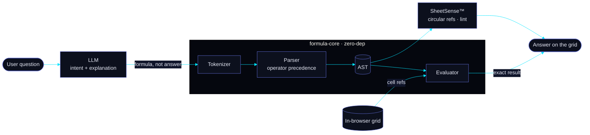

<picture>
  <source media="(prefers-color-scheme: light)" srcset="assets/light/h-systems.svg" />
  
</picture>

<table width="100%">
  <thead>
    <tr><th align="left">System</th><th align="left">Class</th><th align="left">Uplink</th><th align="left">Release</th><th align="left">Pipeline</th></tr>
  </thead>
  <tbody>
    <tr>
      <td><a href="https://www.excelmasters.in/"><b>excelmasters.in</b></a></td>
      <td><code>web platform</code></td>
      <td></td>
      <td></td>
      <td></td>
    </tr>
    <tr>
      <td><a href="https://chic-builder.vercel.app/"><b>chic-builder</b></a></td>
      <td><code>pwa</code></td>
      <td></td>
      <td></td>
      <td></td>
    </tr>
    <tr>
      <td><a href="https://github.com/Kukzze/mongo-next-sentinel"><b>mongo-next-sentinel</b></a></td>
      <td><code>library</code></td>
      <td></td>
      <td></td>
      <td> </td>
    </tr>
    <tr>
      <td><a href="https://github.com/ExcelMasters-in/formula-core"><b>formula-core</b></a></td>
      <td><code>library</code></td>
      <td></td>
      <td></td>
      <td></td>
    </tr>
    <tr>
      <td><a href="https://github.com/ChicBuilder/chic-core"><b>chic-core</b></a></td>
      <td><code>library</code></td>
      <td></td>
      <td></td>
      <td></td>
    </tr>
    <tr>
      <td><a href="https://github.com/Kukzze/astrarium"><b>astrarium</b></a></td>
      <td><code>runelite plugin</code></td>
      <td></td>
      <td></td>
      <td></td>
    </tr>
    <tr>
      <td><a href="https://github.com/Kukzze/grotesque-solar-blasts"><b>grotesque-solar-blasts</b></a></td>
      <td><code>runelite plugin</code></td>
      <td></td>
      <td></td>
      <td></td>
    </tr>
  </tbody>
</table>

<picture>
  <source media="(prefers-color-scheme: light)" srcset="assets/light/h-packages.svg" />
  
</picture>

<a href="https://github.com/Kukzze/mongo-next-sentinel">
<picture>
  <source media="(prefers-color-scheme: light)" srcset="assets/light/p-sentinel.svg" />
  
</picture>
</a>

<b>⟢ Architecture: mongo-next-sentinel event pipeline & circuit breaker</b> (click to expand)

 

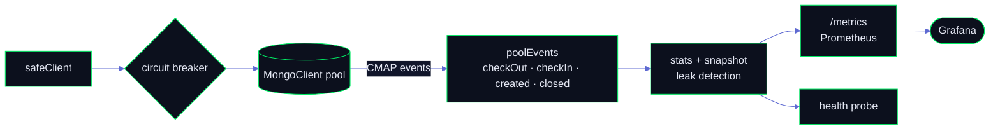

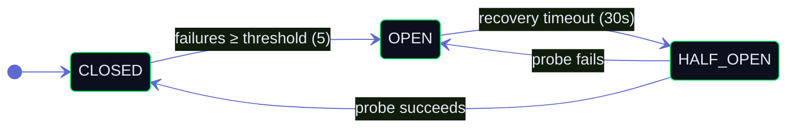

  <a href="https://github.com/ExcelMasters-in/formula-core">
  <picture>
    <source media="(prefers-color-scheme: light)" srcset="assets/light/p-formulacore.svg" />
    
  </picture>
  </a>
  <a href="https://github.com/ChicBuilder/chic-core">
  <picture>
    <source media="(prefers-color-scheme: light)" srcset="assets/light/p-chiccore.svg" />
    
  </picture>
  </a>
  <a href="https://github.com/Kukzze/astrarium">
  <picture>
    <source media="(prefers-color-scheme: light)" srcset="assets/light/p-astrarium.svg" />
    
  </picture>
  </a>
  <a href="https://github.com/Kukzze/grotesque-solar-blasts">
  <picture>
    <source media="(prefers-color-scheme: light)" srcset="assets/light/p-grotesque.svg" />
    
  </picture>
  </a>

<picture>
  <source media="(prefers-color-scheme: light)" srcset="assets/light/h-upstream.svg" />
  
</picture>

<a href="https://github.com/PaperMC/Paper/pull/14427">
<picture>
  <source media="(prefers-color-scheme: light)" srcset="assets/light/hof-paper.svg" />
  
</picture>
</a>

<a href="https://github.com/PaperMC/Paper/pull/14430">
<picture>
  <source media="(prefers-color-scheme: light)" srcset="assets/light/hof-paper-2.svg" />
  
</picture>
</a>

<table width="100%">
  <thead>
    <tr><th></th><th align="left">Project</th><th align="left">Contribution</th><th align="left">Impact</th><th align="left">Status</th></tr>
  </thead>
  <tbody>
    <tr>
      <td></td>
      <td><a href="https://github.com/biomejs/biome/pull/12704"><b>biomejs/biome</b> #12704</a></td>
      <td>Support npm's <code>SEE LICENSE IN &lt;file&gt;</code> in <code>noUntrustedLicenses</code></td>
      <td>Rust lint rule, UTF-8 boundary-safe parsing</td>
      <td></td>
    </tr>
    <tr>
      <td></td>
      <td><a href="https://github.com/discordjs/discord.js/pull/11667"><b>discordjs/discord.js</b> #11667</a></td>
      <td>Recover from invalid transition when <code>lastTransitionId</code> is 0</td>
      <td>DAVE MLS end-to-end-encrypted voice session recovery</td>
      <td></td>
    </tr>
    <tr>
      <td></td>
      <td><a href="https://github.com/mdn/content/pull/46305"><b>mdn/content</b> #46305</a></td>
      <td>Document origin-keyed agent clusters by default</td>
      <td>WHATWG HTML process-isolation semantics and the <code>?0</code> opt-out</td>
      <td></td>
    </tr>
    <tr>
      <td></td>
      <td><a href="https://github.com/DefinitelyTyped/DefinitelyTyped/pull/75855"><b>DefinitelyTyped</b> #75855</a></td>
      <td><code>jqueryui</code>: <code>JQuery.TriggeredEvent</code> for widget callbacks</td>
      <td>Full contextual inference on widget event handlers</td>
      <td></td>
    </tr>
    <tr>
      <td></td>
      <td><a href="https://github.com/DefinitelyTyped/DefinitelyTyped/pull/75886"><b>DefinitelyTyped</b> #75886</a></td>
      <td><code>wordpress__block-editor</code>: allow <code>false</code> for <code>renderAppender</code></td>
      <td>Matches Gutenberg runtime for <code>InnerBlocks</code> and <code>BlockList</code></td>
      <td></td>
    </tr>
    <tr>
      <td></td>
      <td><a href="https://github.com/discord-jda/JDA/pull/3162"><b>discord-jda/JDA</b> #3162</a></td>
      <td>Add <code>getChannel()</code> to <code>MessageCreateAction</code></td>
      <td>Java Discord API ergonomics</td>
      <td></td>
    </tr>
    <tr>
      <td></td>
      <td><a href="https://github.com/runelite/runelite/pull/20613"><b>runelite/runelite</b> #20613</a></td>
      <td>Skill calculator: Blood Moon Rises methods</td>
      <td>Open-source OSRS client used by millions of players</td>
      <td></td>
    </tr>
    <tr>
      <td></td>
      <td><a href="https://github.com/runelite/runelite/pull/20628"><b>runelite/runelite</b> #20628</a></td>
      <td>Clues: shorten Falo flail requirement text</td>
      <td>Requirement now fits the clue infobox</td>
      <td></td>
    </tr>
    <tr>
      <td></td>
      <td><a href="https://github.com/Zoinkwiz/quest-helper/pull/2875"><b>Zoinkwiz/quest-helper</b> #2875</a></td>
      <td>Karamja Hard: accept any crossbow for the grapple shortcut</td>
      <td>Fixes a false "missing item" for players with other crossbows</td>
      <td></td>
    </tr>
  </tbody>
</table>

<picture>
  <source media="(prefers-color-scheme: light)" srcset="assets/light/h-stack.svg" />
  
</picture>

  <picture>
    <source media="(prefers-color-scheme: light)" srcset="https://skillicons.dev/icons?i=ts,js,rust,java,html,css,bash&theme=light" />
    
  </picture>
    
  <picture>
    <source media="(prefers-color-scheme: light)" srcset="https://skillicons.dev/icons?i=nextjs,react,nodejs,bun,tailwind,vite,mongodb,vercel,aws,githubactions&theme=light" />
    
  </picture>

<picture>
  <source media="(prefers-color-scheme: light)" srcset="assets/light/h-matrix.svg" />
  
</picture>

<picture>
  <source media="(prefers-color-scheme: light)" srcset="profile-3d-contrib/profile-obsidian-light.svg" />
  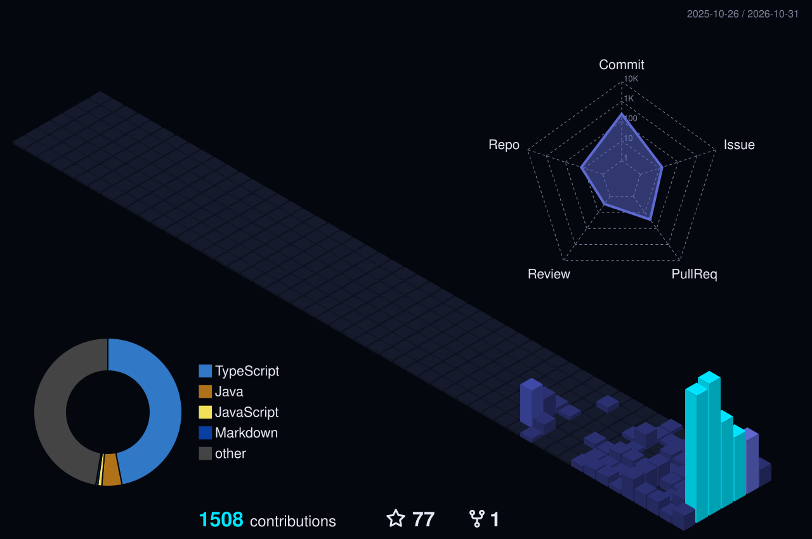
</picture>

<picture>
  <source media="(prefers-color-scheme: dark)" srcset="https://raw.githubusercontent.com/Kukzze/Kukzze/output/pacman-contribution-graph-dark.svg" />
  <source media="(prefers-color-scheme: light)" srcset="https://raw.githubusercontent.com/Kukzze/Kukzze/output/pacman-contribution-graph.svg" />
  
</picture>

<picture>
  <source media="(prefers-color-scheme: light)" srcset="assets/light/footer.svg" />
  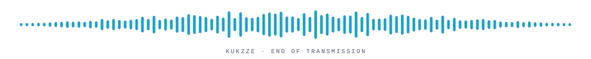
</picture>
